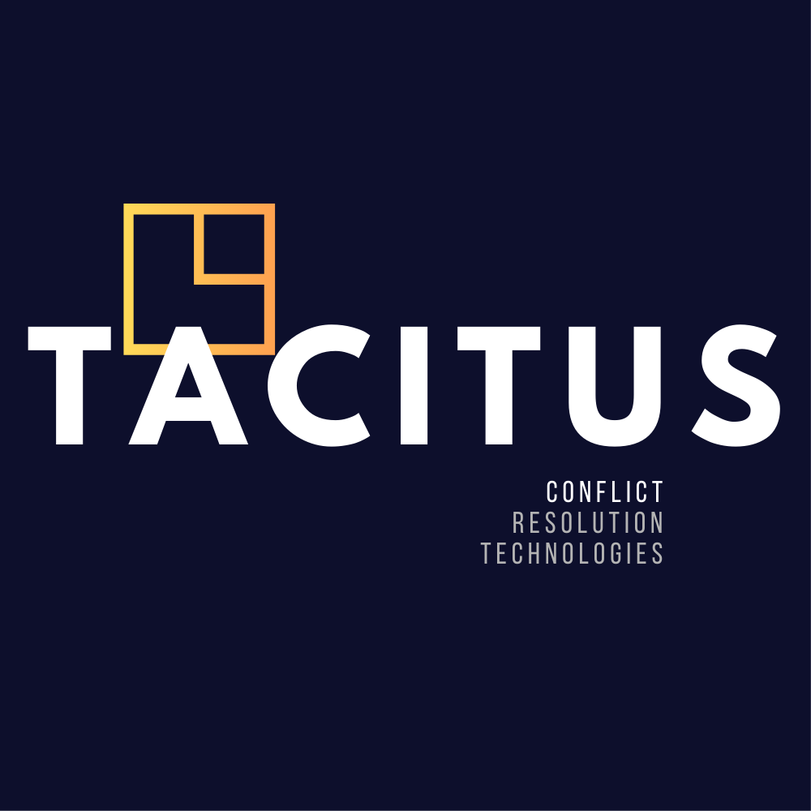
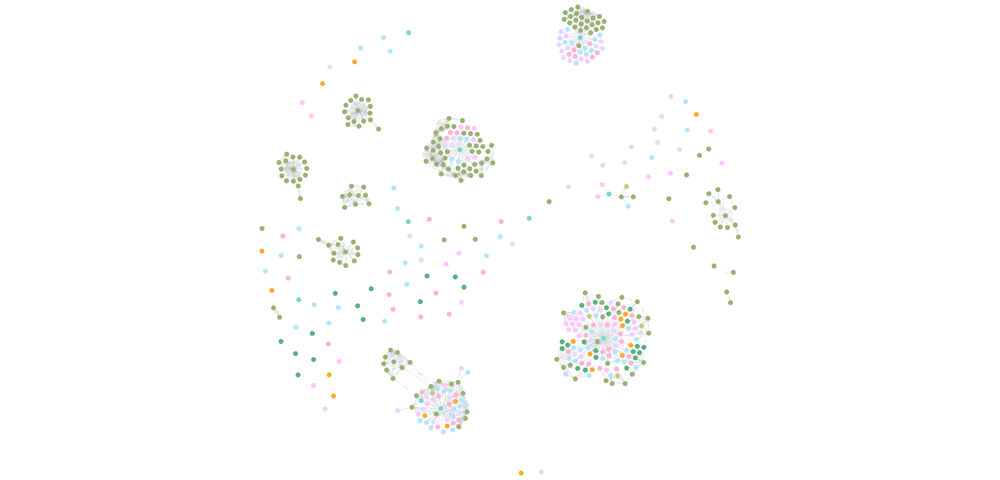

<p align="center">
  
</p>

<h1 align="center">TACITUS Knowledge Pipeline</h1>

<p align="center"><strong>A public reference notebook for evidence-linked knowledge graphs in policy and conflict analysis.</strong></p>

<p align="center">
  <a href="https://tacitus.me">Website</a> ·
  <a href="#quick-start">Quick start</a> ·
  <a href="#pipeline">Pipeline</a> ·
  <a href="#limitations">Limitations</a>
</p>

<p align="center">
  
  
  
  
  
  <a href="https://colab.research.google.com/github/sargonxg/TACITUS-Knowledge-Pipeline-open/blob/main/TACITUS_PIPELINE_Workbench_v8.ipynb"></a>
</p>

---

## 30-second read

- **What it is:** a compact, inspectable pipeline that converts source text into typed graph objects linked to evidence spans.
- **What it demonstrates:** structured extraction, entity resolution, graph construction, reusable Cypher queries, and deterministic post-extraction analysis such as graph scoring and clustering.
- **What it is not:** a validated decision system, a complete TACITUS deployment, or proof that graph-based analysis is automatically correct.
- **Best starting point:** open the Colab notebook, run the included example, and inspect how each graph object is connected to its source.

<p align="center">
  
</p>

## Why this repository exists

Policy and conflict analysis often requires more than a fluent summary. Analysts need to know who made a claim, which source supports it, how actors and issues are connected, where accounts diverge, and which conclusions are direct observations rather than inferences.

This repository presents a simplified version of that workflow in a form that can be inspected and modified. A model proposes structured objects from text; validation and graph code then organize those objects into a queryable representation. The graph supports repeatable operations over the accepted extraction output.

The distinction matters: **deterministic graph operations do not make upstream extraction infallible.** They make later transformations easier to inspect, reproduce, test, and challenge.

## Pipeline

```text
source documents
      │
      ▼
segmentation and source-span indexing
      │
      ▼
model-assisted structured extraction
      │
      ▼
schema validation and entity resolution
      │
      ▼
evidence-linked knowledge graph
      │
      ├── reusable Cypher queries
      ├── contradiction candidates
      ├── actor and issue network measures
      ├── claim clustering
      └── analyst review and export
```

The reference implementation focuses on a small conflict-analysis ontology and can be adapted to other policy domains. Typical objects include actors, claims, interests, constraints, leverage, commitments, events, narratives, source documents, and evidence spans.

## What “deterministic” means here

Once extraction output has been accepted and normalized, operations such as graph traversal, configured similarity thresholds, PageRank, clustering with fixed parameters, and Cypher queries can be rerun under recorded settings. That improves reproducibility and auditability at the transformation layer.

It does **not** establish that:

- the extraction captured every relevant fact;
- a source itself is accurate;
- a similarity score represents a material contradiction;
- a central actor is necessarily the most politically important actor;
- a cluster is the only defensible grouping; or
- the resulting graph should determine a policy judgment.

Evidence links make an output reviewable; they do not convert an inference into truth.

## Repository contents

| Path | Purpose |
| --- | --- |
| [`TACITUS_PIPELINE_Workbench_v8.ipynb`](TACITUS_PIPELINE_Workbench_v8.ipynb) | Colab-oriented walkthrough and demonstration |
| [`TACITUS_PIPELINE_NoOutput.ipynb`](TACITUS_PIPELINE_NoOutput.ipynb) | Clean notebook for local execution and review |
| [`queries/`](queries/) | Reusable graph queries |
| [`requirements.txt`](requirements.txt) | Python dependencies |
| [`.env.example`](.env.example) | Configuration template; never commit real credentials |
| [`assets/`](assets/) | Diagrams and example visual material |

## Quick start

### Colab

Use the badge at the top of this page. Review each cell before running it and provide credentials only through the notebook environment or an approved secret mechanism.

### Local

```bash
git clone https://github.com/sargonxg/TACITUS-Knowledge-Pipeline-open.git
cd TACITUS-Knowledge-Pipeline-open

python -m venv .venv
source .venv/bin/activate       # Windows: .venv\Scripts\activate
python -m pip install --upgrade pip
pip install -r requirements.txt
cp .env.example .env
jupyter lab
```

A graph database and model-provider configuration are required for the complete workflow. Consult the notebook and `.env.example` for the current variables. Use synthetic or public material until the processing path, provider terms, retention, access controls, and local logging behavior have been reviewed.

## Expected workflow

1. Load and segment source material.
2. Assign stable identifiers and retain source-span offsets.
3. Ask the configured model to return typed extraction objects.
4. Validate the returned shape and normalize identifiers.
5. resolve duplicate or aliased actors conservatively.
6. Write accepted objects and evidence links to the graph.
7. Run explicit queries and graph algorithms.
8. Inspect the source behind material claims and revise the graph where needed.
9. Record configuration, thresholds, provider, model, and code version with any reported result.

## Evaluation

The notebook is a reference implementation, not a benchmark result. A serious evaluation should separate at least four questions:

- extraction accuracy against annotated source material;
- source-span precision and attribution quality;
- stability of entity resolution and graph construction;
- usefulness and error rates of downstream queries or scores.

Comparisons should preserve prompts, model identifiers, prediction files, code commit, thresholds, and human-review protocol. The [TCGC benchmark](https://github.com/sargonxg/TCGC_TACITUS-Conflict-Grammar-Corpus_BENCHMARK) is the related TACITUS project for developing a more formal evaluation surface.

## Relationship to current TACITUS work

This repository is intentionally smaller and easier to inspect than the current product architecture.

- [DIALECTICA](https://github.com/sargonxg/A3_DIALECTICAbyTACITUS_v3) builds reviewable, portable context capsules.
- [AGON](https://github.com/sargonxg/AGON) explores evidence-linked conflict perception.
- [KAIROS](https://github.com/sargonxg/KAIROS-temporal-vision-TACITUS) explores temporal knowledge graphs.
- [Tacitus Policy Workbench](https://github.com/sargonxg/tacitus-political-policy-second-brain) is an active integration lab for document ingestion, policy context, and local-first workflows.

## Limitations

Model extraction can omit, merge, misattribute, or invent objects. Entity resolution can collapse distinct actors. Embeddings and similarity thresholds can produce misleading candidates. Graph algorithms measure formal structure, not political significance or moral weight. Sources may be partial, strategic, deceptive, or mutually inconsistent. Human review and domain expertise remain necessary.

Do not use this repository to make unattended legal, employment, clinical, security, eligibility, or other high-impact decisions about individuals.

## Contributing and license

See [CONTRIBUTING.md](CONTRIBUTING.md). Licensed under the Apache License 2.0; see [LICENSE](LICENSE).
