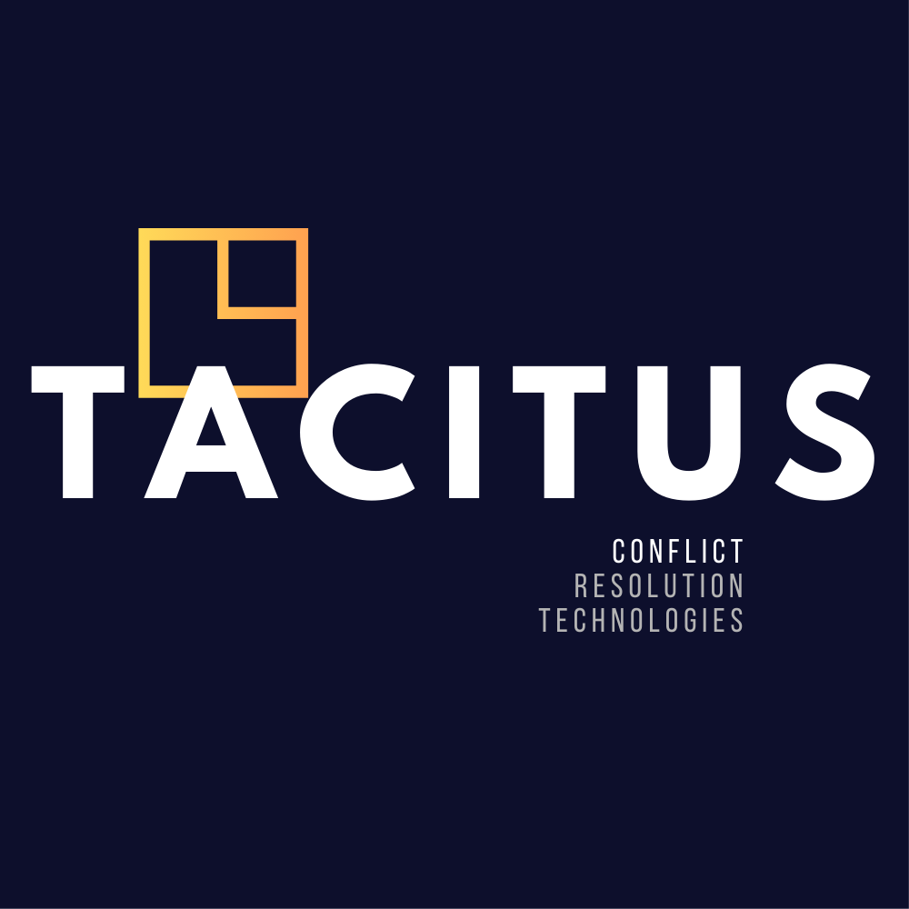
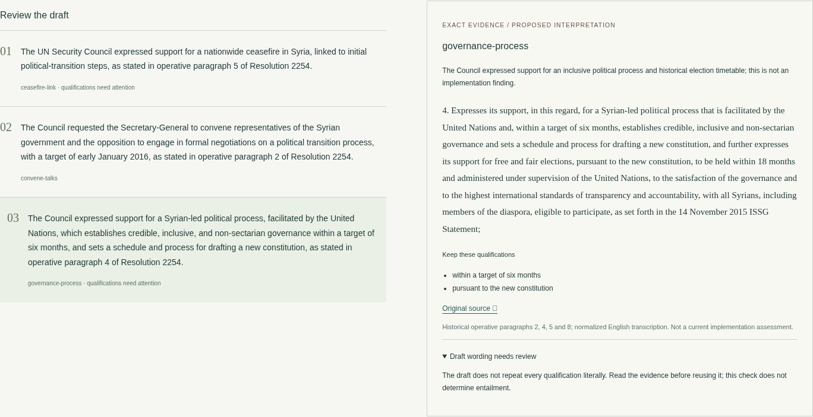

# TACITUS Knowledge Pipeline

<!-- tacitus-practical-entry -->
## Purpose, code and a playable introduction

Compile exact source passages and authored annotations into a bounded policy context, a review worksheet and an inspectable artifact.

**Local reference implementation.** The credential-free compiler and optional model adapters are separate workflows. Cross-repository capsule formats are not interchangeable.

[Setup, code walkthrough, research & verification](TACITUS_GUIDE.md) · [Play the original 8-bit teaching adventure](tacitus-demo/index.html) · [Demo credits](tacitus-demo/CREDITS.md)


*Original concept illustration; the scene and documents are fictional. [Artwork and reuse](https://github.com/sargonxg/sargonxg/blob/a91027079c8ff8ebbd3623898a5e03a13cd80df5/docs/VISUAL_IDENTITY.md).*

Research: [RAG](https://arxiv.org/abs/2005.11401), [long-context evidence use](https://arxiv.org/abs/2307.03172), [GraphRAG](https://arxiv.org/abs/2404.16130). [What TACITUS borrows, adds and still needs to measure](https://github.com/sargonxg/sargonxg/blob/main/docs/RESEARCH_AND_DESIGN.md).
<!-- /tacitus-practical-entry -->


**Data infrastructure for Policy / Political AI.**

Turn exact policy sources into an explicit knowledge structure, a task-specific capsule and an inspectable artifact. The goal is better saliency and efficiency in AI generation. Assembly behavior is tested here; generation-quality and whole-process efficiency gains still need evaluation.

[Website](https://tacitus.me/) · [Build guide](https://tacitus.me/developers/) · [TACITUS organization](https://github.com/TACITUS-me) · [LinkedIn](https://www.linkedin.com/company/tacitus-me)

## Run the reference

Python 3.11+. No runtime dependencies, credentials or model calls.

```sh
git clone https://github.com/sargonxg/TACITUS-Knowledge-Pipeline-open.git
cd TACITUS-Knowledge-Pipeline-open/reference-pipeline
PYTHONPATH=src python -m tacitus_pipeline build \
  --input examples/assessment/collection.json \
  --ontology ontology/policy.json \
  --layer layers/assessment-evidence.json \
  --question "Map assessment evidence and review roles." \
  --output build/assessment
```

The example uses original adopted EU AI Act and GDPR passages. It preserves the conditional relationship between assessments, the DPO designation condition and the distinct AI Office template role. Authored mappings remain proposals for review; this is not a current legal-applicability assessment.

Open `build/assessment/brief.md`, then inspect `capsule.json`, `graph.json`, `graph.jsonld`, `workflow.json` and `receipt.json`. Required evidence stays whole; an insufficient byte budget is refused. Source text is reference data, not action authority.

## Generate and inspect a real draft

The [Syria policy workflow](reference-pipeline/docs/model-workflows.md) adds explicit cloud/local model adapters and a bounded evidence-inspection agent. The model can inspect selected evidence IDs, then propose a cited draft. Code retains exact passages and qualifications; human approval is never granted automatically.

[Actual two-step Cloudflare run](reference-pipeline/examples/syria-negotiation/agent-step-2) · [Flat versus structured recordings](reference-pipeline/examples/syria-negotiation) · [Research index: 12 papers](research/README.md)



The screenshot shows a recorded run in the separate [Workbench](https://github.com/sargonxg/tacitus-workbench). It does not imply a live hosted PRAXIS bridge. Both flat and structured drafts resolve their citations; structured input used more total tokens in this one-task comparison.

## Inspect or change a layer

| Part | Source and guide |
| --- | --- |
| Sources | [Exact text, source editions and evidence spans](reference-pipeline/docs/sources.md) |
| Ontology | [Entity types and valid relationships](reference-pipeline/docs/ontology.md) |
| Semantic layer | [Task selection, qualifications and review checks](reference-pipeline/docs/semantic-layers.md) |
| Context and artifact | [Bounded assembly and the review-sheet workflow](reference-pipeline/docs/workflows.md) |
| Implementation | [Standard-library Python core](reference-pipeline/src/tacitus_pipeline/core.py) |
| Outputs | [Populated, inspectable example files](reference-pipeline/examples/assessment/expected) |

## Verify and benchmark

From `reference-pipeline`:

```sh
PYTHONPATH=src python -m unittest discover -s tests -v
python benchmarks/run.py
```

The reference tests check quotation tampering, source editions, lost conditions, ontology constraints, dangling references, proposed review state, duplicate editions, Unicode, context limits and explicit overwrite. A GitHub Actions workflow is supplied for the credential-free checks; no hosted CI result is claimed for this update.

[Assembly measurements](reference-pipeline/benchmarks/assembly-results.json) test evidence preservation and byte limits. They are not model-quality or token-savings measurements. The [model-output evaluation plan](reference-pipeline/benchmarks/model-evaluation-plan.json) remains work in progress: held-out tasks, matched evidence, blinded domain review and complete costs.

## Development boundaries

The working reference uses authored annotations. Automatic extraction, expert validation and provider adapters remain in development. `workflow.json` is a read-only plan, not live agent execution or an import contract for another application.

[PRAXIS](https://praxis.tacitus.me/) is the invitation-only workspace for capsules and artifacts; AI generation is currently paused and paid upgrades are unavailable. [The local workbench](https://github.com/sargonxg/tacitus-workbench), [DIALECTICA](https://github.com/sargonxg/A3_DIALECTICAbyTACITUS_v3) and [KAIROS](https://github.com/sargonxg/KAIROS-temporal-vision-TACITUS) have separate contracts and development status.

## Earlier notebook experiments

The existing notebooks, queries, examples and tests remain available. Their [earlier documentation](docs/legacy-notebook-readme.md) describes separate service dependencies and historical experiments. They have not been revalidated by the new reference tests. Verify provider availability, costs and data permissions before running them. Temperature zero does not make semantic interpretation deterministic.

## Rights

Apache-2.0 code; see [LICENSE](LICENSE). Source documents retain their own attribution and terms. The example includes rights and scope notes; inclusion does not relicense external material. See [SECURITY.md](SECURITY.md) before reporting a vulnerability.

### Inspect diplomatic language and review history

The [credential-free language-review tool](reference-pipeline/docs/diplomatic-language.md) extends the existing compiler with source-linked wording choices, draft versions, discussion records and a review graph. It uses attributed historical public evidence and clearly synthetic editorial drafts. It performs no inference or semantic approval. [Open the browser desk](https://tacitus.me/workbench/#language).

## Format boundaries and current local checks

[Evidence-format compatibility and reader boundaries](https://github.com/sargonxg/tacitus-workbench/blob/main/docs/FORMAT_COMPATIBILITY.md) distinguish the public reference, native readers, source-kit selections and the separately owned App contracts. No automatic cross-format converter or App authorization is implied. On 12 November 2026, the documented credential-free reference suite passed all 42 tests and the historical Syria graph/context/review-sheet build passed. The organization starter retains its existing reviewed submodule pin; no model/provider request or deployment was performed.
